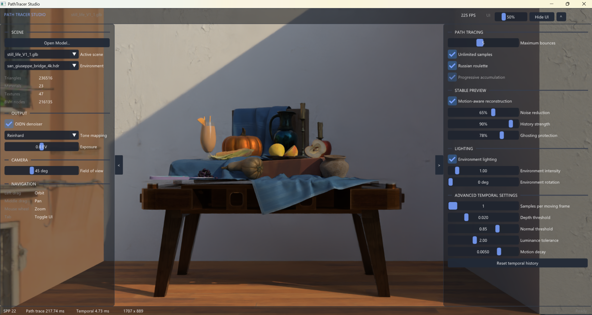
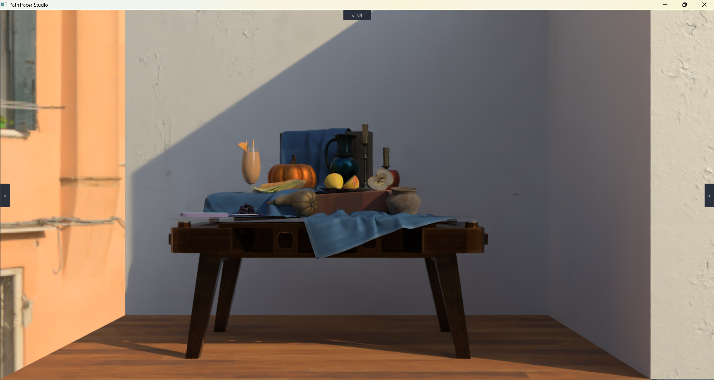
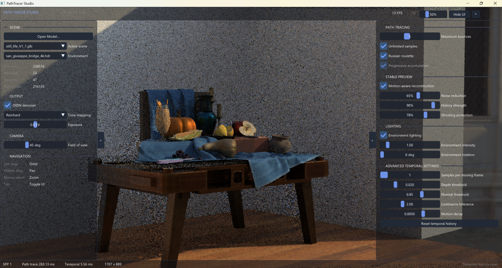
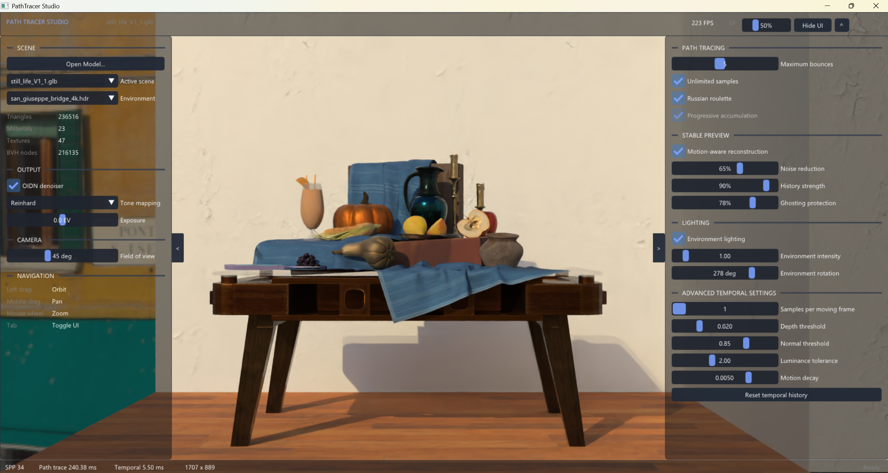
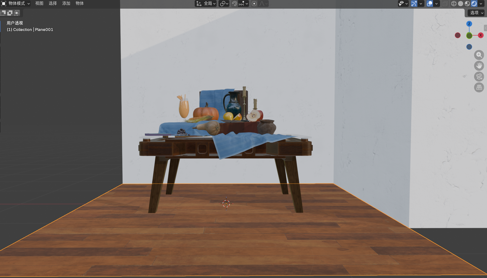

# PathTracer Studio

An interactive GPU path tracing renderer built with **C++**, **OpenGL**, and **GLSL**.
The project implements physically based light transport in OpenGL fragment shaders, without a dedicated hardware ray-tracing API. It separates low-sample camera previews from stationary image refinement and exposes the trade-off between noise suppression, history reuse, and interaction response.

**Author: Li Shouchuan.** Individual project in graphics programming, application design, and system integration.

**One-click launch:** double-click **`GPU_Renderer.bat`** in the project root to start the supplied Windows build. The launcher sets the working directory automatically. No terminal commands or Visual Studio are required to run the supplied build.

`C++` · `OpenGL 3.3` · `GLSL` · `GPU Path Tracing` · `BVH` · `PBR` · `Temporal Reconstruction` · `Dear ImGui`



## Project Overview

PathTracer Studio explores how an offline-style path tracer can be turned into an approachable interactive application. The system separates CPU-side scene preparation from GPU-side light transport: C++ handles model loading, camera interaction, material data, BVH construction, and UI state, while GLSL shaders perform ray traversal, path sampling, temporal reconstruction, and display processing. A transparent, collapsible interface keeps the rendered scene visible while exposing the parameters that most strongly affect quality, stability, and performance.

I independently designed and developed the application, integrating scene preparation, GPU rendering passes, camera controls, and the interface. My engineering decisions focus on how rendering state, temporal history, and progressive accumulation respond to user edits. Third-party libraries supply platform services, UI widgets, asset parsing, CPU BVH construction/translation, and denoising. Example geometry and HDR images are external assets, not my original artwork.

## Core Features

### GPU Path Tracing

- Monte Carlo light transport implemented in OpenGL fragment shaders.
- Global illumination, soft shadows, glossy reflection, refraction, metallic response, and glass transmission.
- Direct-light sampling, multiple importance sampling, and Russian roulette termination.
- Full-resolution previews with 1–8 samples per pixel (SPP) per edited frame.
- Tiled progressive accumulation when the scene and camera remain unchanged.

### Scene Acceleration and Asset Pipeline

- Two-level acceleration structure with mesh-level BLAS and scene-level TLAS organization.
- RadeonRays CPU BVH construction/translation, integrated with stack-based GLSL traversal to skip irrelevant bounds and triangles.
- BVH nodes, triangle indices, vertices, and normals stored in texture buffers; materials and instance transforms stored in floating-point textures.
- Texture maps resized into a common 2D texture array for indexed shader access.
- OBJ, glTF, and GLB scene loading with multi-material and texture support.
- Runtime model selection, HDR environment switching, and scene statistics including triangles, materials, textures, and BVH nodes.

### Physically Based Shading and Lighting

- Disney-style physically based material sampling.
- HDR environment lighting with a CPU-built luminance CDF for importance sampling, adjustable intensity, and rotation.
- Scene-defined rectangular, spherical, and distant lights. The current UI exposes environment lighting controls, not a general light-position editor.
- ACES, Reinhard, and linear output modes with exposure adjustment.
- Optional Intel Open Image Denoise (OIDN) for stationary output. The current integration reads back tone-mapped color, filters it on the CPU, and uploads the result. It does not pass albedo/normal guides to OIDN or denoise linear HDR before tone mapping.

### Selectable Preview Reconstruction

Camera motion invalidates stationary accumulation. Fresh low-SPP samples remain noisy, but excessive historical reuse can retain outdated surfaces. The current UI makes this decision inspectable rather than hiding it behind a single on/off switch.

In the right panel, open **STABLE PREVIEW → Preview method**:

| UI mode | Implementation and purpose |
|---|---|
| **Motion-aware** (default) | Geometry-validated history gathering, adaptive temporal weights, and confidence-dependent filtering of current samples. |
| **TAA (fixed weight)** | Reprojected history with 3×3 current-neighborhood color clipping and a constant history weight. A comparison baseline, not the absence of ghosting protection. |
| **Off (fresh samples)** | Display the current preview samples without temporal reuse. Stationary progressive accumulation still operates. |

#### How Motion-aware reconstruction works

1. **Generate preview evidence.** One GPU pass outputs radiance, motion vectors, first-hit positions, and normals. Motion vectors project the first hit through the current and previous camera matrices.
2. **Validate before interpolation.** At the reprojected location, check depth and normal agreement for each of the four history texels before combining them. This avoids mixing unrelated surfaces at boundaries and newly revealed regions.
3. **Estimate reliability.** Combine geometry confidence, a variance-normalized luminance residual, pixel motion, and accumulated history length. Clamp historical color to the valid local neighborhood before blending.
4. **Adapt the resolve.** Reduce historical influence when confidence falls. In Motion-aware mode, a same-surface 3×3 filter then contributes more strongly to current-frame reconstruction. Invalid history or out-of-bounds reprojection falls back to fresh samples.

**Noise reduction** controls current-frame filtering. **History strength** caps Motion-aware reuse and sets the fixed TAA weight. **Ghosting protection** jointly adjusts depth, normal, and luminance thresholds. Advanced controls expose these thresholds and motion decay individually. Inapplicable controls are disabled; **Samples per moving frame** remains available in every mode. Switching methods resets temporal history and restarts stationary accumulation.

This is camera-motion reconstruction for the current scene, not a general solution for deforming or animated geometry. Noise, residual ghosting, and detail loss remain possible. Comparative superiority requires matched measurements, not just a cleaner-looking still image.

### Interaction and Interface Design

- Scene-first layout with transparent side panels that preserve visual focus on the render.
- Independently collapsible left, right, top, and status panels.
- Adjustable UI opacity and one-click distraction-free viewing.
- Interactive controls for path depth, sample limits, preview method, environment lighting, output processing, and field of view.
- A read-only progressive-accumulation indicator, rather than a switch that disables stationary accumulation.
- Fixed-width performance readout for stable FPS and timing display.

## Gallery

| Final render | Moving-camera preview |
|---|---|
|  |  |

| Alternative lighting | Test scene |
|---|---|
|  |  |

## System Architecture

```text
CPU scene preparation
  OBJ / glTF / GLB + textures + HDR
    -> parsing and material processing
    -> RadeonRays BLAS / TLAS + environment CDF
    -> upload packed GPU buffers and textures

GPU rendering: choose a path from the current render state
  Scene/camera edited
    -> full-resolution low-SPP path tracing + first-hit/motion outputs
    -> Motion-aware / fixed-weight TAA / fresh samples
    -> ping-pong history buffers -> tone mapping -> preview display

  Scene/camera unchanged
    -> tiled path tracing -> progressive sample accumulation
    -> tone-mapped output, with display-buffer swap per completed sweep
    -> optional CPU OIDN: color readback -> filter -> GPU upload
    -> output display
```

These are separate state-dependent paths. Temporal preview reconstruction does not replace stationary accumulation. Double-buffered output keeps the last completed sweep visible while the next sweep is being rendered.

## Download and Run

### Current Local Build

From the project root, double-click **`GPU_Renderer.bat`** for one-click startup. It automatically switches to `bin` and starts **`PathTracerRenderer_preview_modes.exe`**, which contains the preview-method selector. Keep the launcher alongside the `bin`, `assets`, and `src` folders. The existing `PathTracerRenderer_research.exe` and `PathTracerRenderer_research_ui.exe` are retained as earlier builds.

Alternatively, run from PowerShell:

```powershell
Set-Location .\bin
.\PathTracerRenderer_preview_modes.exe
```

Keep the working directory at `bin`: scenes, shaders, HDR maps, and captures use paths relative to it. The current executable has passed compilation and a `--help` startup check. This does not constitute a visual comparison or performance benchmark.

### Portable Windows Package

Portable packages are distributed through [GitHub Releases](https://github.com/zhD1dqz/GPU-PathTracingRenderer/releases).

1. Download `PathTracerStudio-Portable.zip`.
2. Extract the **entire** archive to a normal folder.
3. Double-click `PathTracerStudio.exe`.
4. If the launcher is unavailable, use `Launch.bat` as a fallback.

Visual Studio is **not** required to run the portable package.

**Version distinction:** the current packaging script and portable launchers still select `PathTracerRenderer_research.exe`. Previously packaged binaries may not contain the new preview selector. The source build and local launcher above identify the selectable-preview version. Packaging needs a separate update before distributing that version; check a downloaded package's release notes and bundled executable.

### System Requirements

- Windows 10 or Windows 11, 64-bit.
- A GPU and graphics driver supporting OpenGL 3.3 or later.
- A supported 64-bit CPU for Intel Open Image Denoise.
- Sufficient GPU memory for the selected model, textures, BVH data, and temporal buffers.

## Controls

### Mouse and Interface

| Control | Action |
|---|---|
| Left mouse drag | Orbit the camera |
| Middle mouse drag | Pan the camera |
| Mouse wheel | Zoom |
| Edge arrow buttons | Collapse or restore a side panel |
| Top arrow | Collapse or restore the top bar |
| UI slider | Adjust panel opacity |
| `Hide UI` or `Tab` | Enter or leave distraction-free view |

### Keyboard Shortcuts

| Key | Action |
|---|---|
| `Ctrl + S` | Save the rendered image, without UI panels, to the `captures` folder |
| `1`–`9` | Switch between available scenes |
| `E` | Switch environment maps |
| `R` | Toggle Russian roulette |
| `T` | Toggle tone mapping |
| `M` | Toggle environment lighting |
| `A` | Toggle ACES tone mapping |
| `Y` | Toggle Motion-aware and fresh-sample preview; use the dropdown to select fixed-weight TAA |
| `+` / `-` | Adjust environment intensity |
| `Alt +` / `Alt -` | Rotate the environment map |
| `Shift +` / `Shift -` | Adjust the sample limit |
| `Ctrl +` / `Ctrl -` | Adjust maximum path depth |

## Evaluation and Engineering Trade-offs

| Decision | Benefit | Cost or limitation |
|---|---|---|
| BVH traversal and light/BSDF importance sampling | Avoid irrelevant triangle tests and direct samples toward useful light paths | BVH storage/build costs and additional visibility queries |
| Low-SPP preview plus stationary tiled accumulation | Separate editing response from image convergence | Preview noise, sweep latency, and multiple render buffers |
| Confidence-guided temporal reuse | Make historical influence depend on surface and motion evidence | Extra texture reads, threshold sensitivity, and possible detail loss |
| CPU OIDN on stationary output | Provide optional noise cleanup | GPU readback, CPU execution, upload, and potential detail smoothing |

OpenGL `GL_TIME_ELAPSED` queries measure the edited-view path-tracing pass and temporal resolve separately. They do **not** measure the stationary tile path, OIDN transfers, UI, or complete end-to-end latency. Synchronous query-result retrieval can also stall. Application FPS must not be presented as full-image convergence speed; displayed pass timings represent the last measured preview passes.

For reproducible temporal comparisons, [`research/README.md`](research/README.md) documents the deterministic camera sequence, high-SPP reference generation, fixed-weight baseline, geometry-only ablation, and complete method. The new executable retains the same experiment CLI. For example, run from `bin`:

```powershell
.\PathTracerRenderer_preview_modes.exe --scene ..\assets\myscene\still_life_V1_1.glb --experiment-dir ..\research\runs\fixed_s1 --method fixed --spp 1 --seed 1 --width 640 --height 360
.\PathTracerRenderer_preview_modes.exe --scene ..\assets\myscene\still_life_V1_1.glb --experiment-dir ..\research\runs\proposed_s1 --method proposed --spp 1 --seed 1 --width 640 --height 360
```

An experiment still requires a working OpenGL desktop context. The harness disables OIDN. Match the scene, trajectory, frame index, resolution, path depth, sample count, and seed, and use the same display transform for screenshot comparisons. Inspect moving-frame crops at boundaries or disocclusions rather than only settled final renders. Use an independent seed for the reference. `Ctrl + S` saves a rendered image; use an OS screen capture when you need the complete interface.

**Evidence status:** the repository provides an evaluation workflow, but this README claims no verified FPS increase, speedup percentage, error reduction, or advantage over fixed-weight TAA. Targets in the research documentation are evaluation criteria, not achieved results. Gallery images illustrate project output, not controlled algorithm comparisons.

## Important Notes

- **Extract before running.** Do not launch the executable from inside the ZIP archive.
- **Keep the folder structure unchanged.** The launcher, `bin`, `assets`, and `src/shaders` directories use relative paths and must remain together.
- **Initial noise is expected.** Progressive path tracing begins with a low sample count and becomes cleaner while the camera remains still.
- **Preview behavior depends on the selected method.** Only Motion-aware mode uses the complete confidence estimator. Fresh-sample mode has no temporal reuse; newly revealed regions can remain noisy in any mode.
- **Performance is scene-dependent.** Resolution, path depth, moving-frame samples, material complexity, and BVH size all affect frame time.
- **Update the graphics driver if startup fails.** OpenGL support is provided by the installed GPU driver.
- **Windows SmartScreen may warn about the unsigned launcher.** Confirm that the archive came from this repository before choosing to run it.
- **Large models require patience.** Scene parsing, texture upload, and BVH construction can make the first load slower than subsequent interaction.

## Build from Source

### Prerequisites

- Windows 10/11.
- Visual Studio 2022 with **Desktop development with C++** and the MSVC `v143` toolset.
- Windows 10 SDK.
- An OpenGL 3.3-capable graphics driver.

### Build Steps

1. Clone or download this repository.
2. Open a Visual Studio Developer PowerShell at the repository root.
3. Run the commands below to build Release x64 with the output name expected by the current launcher and copy the required DLLs.
4. Start `GPU_Renderer.bat`, or run the executable with `bin` as its working directory.

From a Visual Studio Developer PowerShell at the repository root:

```powershell
msbuild .\PathTracerRenderer.sln /m /p:Configuration=Release /p:Platform=x64 /p:TargetName=PathTracerRenderer_preview_modes
Copy-Item -LiteralPath .\thirdparty\SDL2\lib\x64\SDL2.dll -Destination .\bin
Copy-Item -LiteralPath .\thirdparty\oidn\lib\OpenImageDenoise.dll -Destination .\bin
Copy-Item -LiteralPath .\thirdparty\oidn\lib\tbb.dll -Destination .\bin
```

The default target in `PathTracerRenderer.sln` produces `bin/PathTracerRenderer_research.exe`. The command overrides only the output name to preserve the earlier binary. The source dependencies are included under `thirdparty`; the matching SDL2, OIDN, and TBB runtime DLLs must remain alongside the executable. Release x64 uses `v143`; older configurations specify `v142`. The current local UI build has been compiled and startup-checked with MinGW. An MSVC build has not been checked for this version.

To regenerate the portable package after a successful build:

```powershell
.\make_portable_release.ps1
```

The archive is generated at `release/PathTracerStudio-Portable.zip`. The script also builds the portable launcher and requires `g++.exe` on `PATH`. It currently packages the research-named executable, not the new local preview-mode executable. Check the selected binary and launcher targets before distributing a new package. Upload the archive as a GitHub Release asset rather than committing it to the source history.

## Repository Structure

```text
assets/          Demo model and HDR environment map
bin/             Local renderer executables and runtime DLLs
captures/        Rendered PNGs saved with Ctrl+S
images/          README and portfolio screenshots
packaging/       Portable launcher fallback and user instructions
research/        Reproducible temporal-reconstruction evaluation scripts
src/core/        Renderer, scene, camera, material, and GPU resource logic
src/loaders/     OBJ and glTF/GLB loading
src/math/        Vector, matrix, and math utilities
src/shaders/     Path tracing, temporal, output, and material GLSL shaders
thirdparty/      External libraries used by the project
tools/           Research UI and launcher build utilities
```

## Third-Party Components and Assets

The repository includes or integrates Dear ImGui, SDL2, OpenGL/gl3w, Intel Open Image Denoise, RadeonRays, stb, tinydir, tinygltf, and tinyobjloader. In particular, RadeonRays supplies CPU BVH construction/translation and Intel OIDN supplies the denoising filter. My work integrates these components with the rendering pipeline and application logic; it does not claim their algorithms or implementations as original library work. Each component remains subject to its own license and attribution requirements.

The demonstration model and HDR environment are included for project presentation. Their original authorship and redistribution terms should be documented before the repository is treated as a reusable asset package.

## License Status

A repository-level open-source license has not yet been selected. Unless a future `LICENSE` file states otherwise, the project is published for portfolio and educational review; third-party code and assets retain their respective licenses and ownership.
